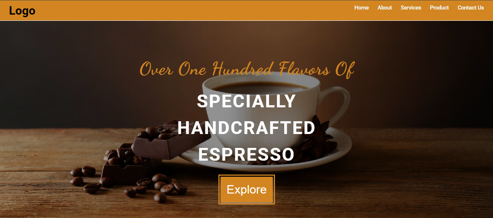

# Coffee Shop

<p align="center">
  
</p>

**Coffee Shop** is a responsive web application that showcases a modern café-style user interface. The project focuses on clean design, smooth user experience, and structured frontend development practices.

This repository serves as a frontend learning project demonstrating how to build an engaging coffee shop website using modern web technologies.

---

## Live Preview

https://sandipan3.github.io/Coffee-Shop/html/home.html

---

## About the Project

The Coffee Shop project is designed to simulate a real-world café website where users can:

- Browse coffee offerings
- Explore a modern landing experience
- View responsive layouts across devices
- Experience smooth UI interactions

Projects in this category typically aim to demonstrate responsive design and interactive UI patterns commonly used in café and small business websites.

---

## Features

- Modern and clean UI
- Fully responsive design
- Fast loading static frontend
- Component-based structure
- Smooth user experience

---

## 🛠️ Tech Stack

- **HTML5**
- **CSS3**
- **JavaScript**
- **Responsive Design Principles**

---

## 🚀 Getting Started

Clone the repository:

```bash
git clone https://github.com/Sandipan3/Coffee-Shop.git
cd Coffee-Shop
```

Then open `index.html` in your browser or use a live server.

---

## 📁 Project Structure

```text
Coffee-Shop/
├── assets/            # Images and static assets
├── css/               # Stylesheets
├── js/                # JavaScript files
├── index.html         # Main entry point
└── README.md
```

---

## Purpose

This project was built to:

- Practice frontend development
- Improve responsive design skills
- Learn clean project structuring

---

## Author

**Sandipan Jha** <br>
GitHub: https://github.com/Sandipan3

---

## License

Distributed under the MIT License.
